# 政策找人全站 UI 巡查

本轮覆盖现有 V3.3 的主要展示与办理界面，保留用户认可的渐变、图案、人物与原有响应宽度。结论来自本轮实际浏览器截图与操作，未用旧截图替代现状。

## 结论

主要页面视觉衔接已经稳定。发现并修复 4 处问题：目录收藏选人无法返回原政策、收藏反馈遮挡导航、计划页残留说明小字、首页说明末字孤行。未发现尚待修复的 P0/P1/P2；两项 P3 作为可选改进保留。

## 逐步记录

### 1. 首页 — 已微调

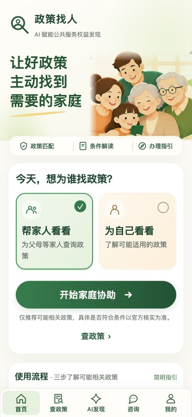

人物插画、品牌渐变和主操作保留，首屏入口清楚。

P3：家庭入口说明的末字单独换行，可微调文字换行。

增加均衡换行，保留原文、色彩和卡片尺寸。

### 2. 成员选择 — 良好

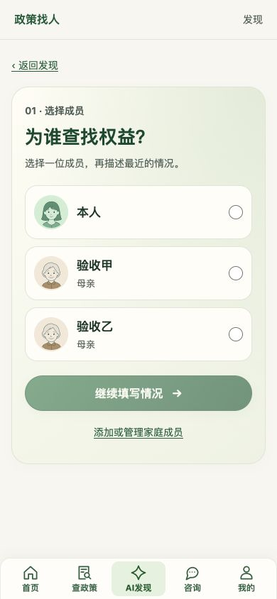

头像、原生单选与浅绿渐变一致；未选择时按钮正确禁用。

### 3. 情况填写 — 良好

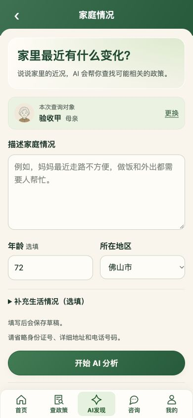

查询对象明确，表单和主按钮完整显示；渐变顶栏与入口衔接正常。

### 4. AI 推荐结果 — 良好

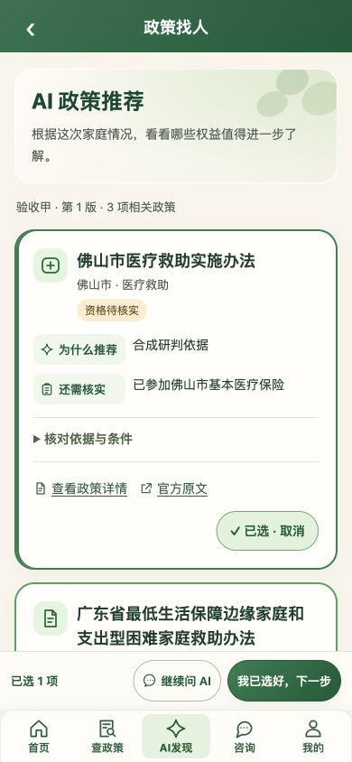

渐变与叶片保留，长说明可完整滚动，底部已选数量和下一步可用。

高层截图接口在滚动后出现偏移，异常图已拒绝，使用显式视口重拍确认。

[补充状态](04-results-scrolled-valid.png)

### 5. 政策详情 — 良好

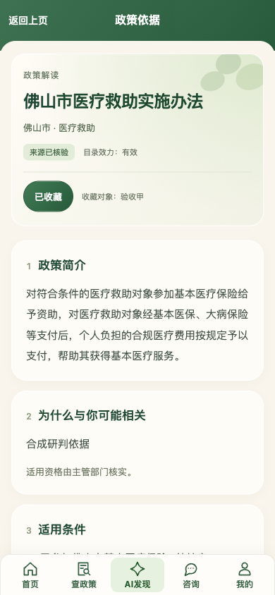

来源、责任部门与返回操作清楚，正文不再被悬浮说明遮挡，收藏成员明确。

[补充状态](05b-policy-source-and-actions.png)

### 6. 少跑腿计划总览 — 已修复

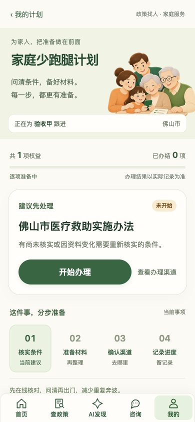

人物插画、真实进度与四步办理路线清楚，主操作首屏可见。

P2：右上角还残留“政策找人 · 家庭服务”，与已确认的简洁偏好不符，应移除。

删除右上残留说明，插画、进度和任务卡保持原样。

### 7. 条件核对 — 良好

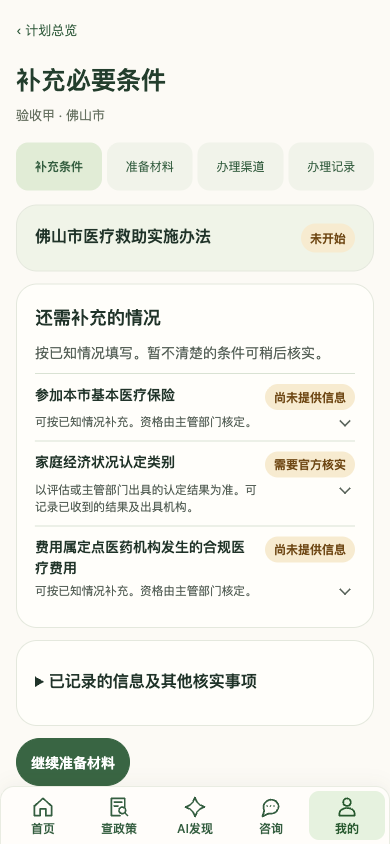

未提供信息、官方核实与已记录事项区分清楚，四步导航及继续按钮完整。

### 8. 材料准备 — 良好

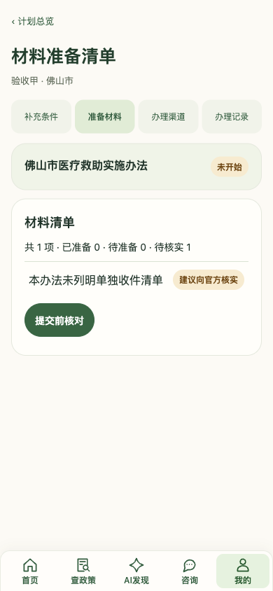

材料待核实状态与数量一致，少数据案例仍清楚，未伪装已准备。

### 9. 办理渠道与提交前核对 — 良好

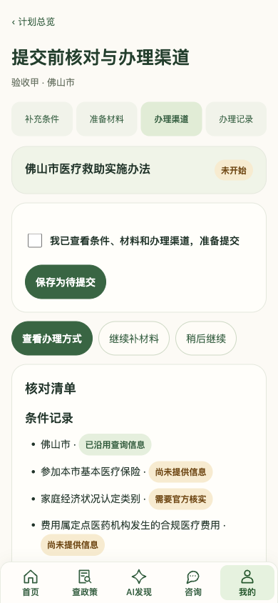

渠道说明、官方原文和实际提交记录入口分明；缺失的地点时间如实标注待确认。

[补充状态](09b-official-channels.png)

### 10. 官方咨询与记录 — 可用，表单较长

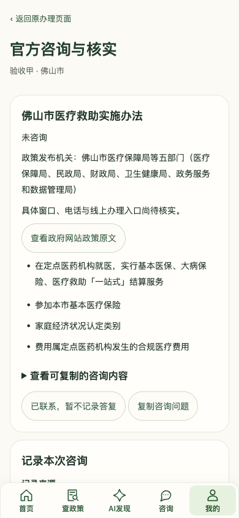

先给官方依据和咨询问题，再记录实际沟通；日期、状态与保存操作可读。

P3：咨询记录字段较多，可把选填的后续材料与要求分组折叠；涉及工作习惯，暂不改动。

[补充状态](10c-consultation-form-actions.png)

### 11. 办理进度与结果记录 — 良好

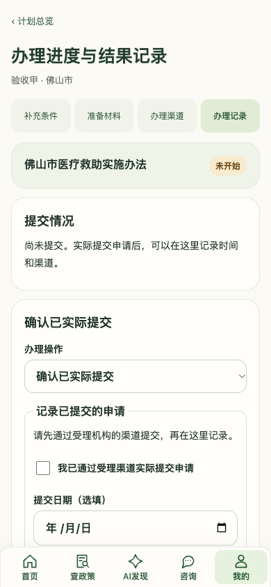

明确区分实际受理渠道提交与本页记录，状态卡与表单没有遮挡。

### 12. 咨询总页 — 良好

准备问题折叠、官方依据目录与已有记录入口分工明确，原有顶栏装饰保留。

### 13. 政策搜索 — 良好，联网结果有验证边界

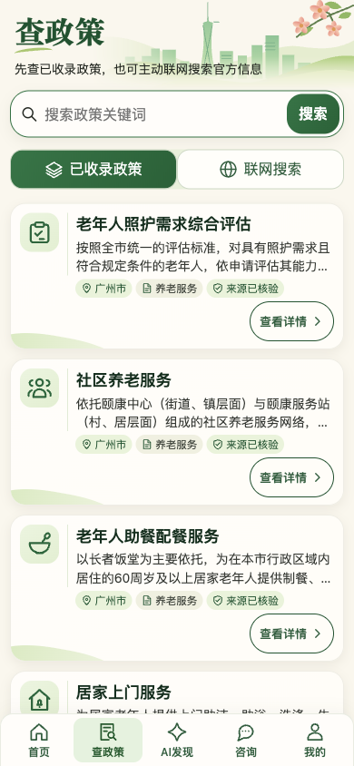

已收录/联网使用正确的选中标签；无结果和加载反馈清楚，装饰与历史页一致。

P3：无结果画面比较简洁，可后续增加更显眼的重试引导。

当前隔离预览的联网搜索为模拟演示，本次只覆盖加载和无结果，不代表真实搜索效果。

[补充状态](13d-online-search-results.png)

### 14. 目录详情与收藏成员选择 — 已修复并走通

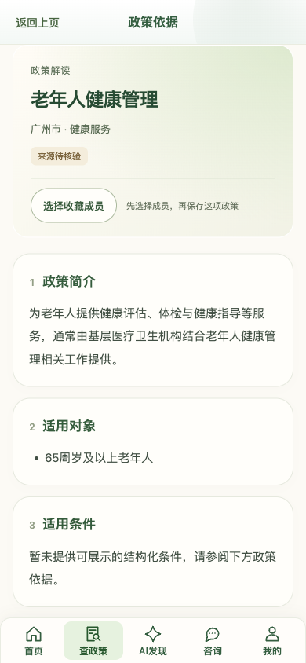

待核验标签、长标题和独立收藏区清楚。

P1：选择收藏成员后停留在我的服务，无法回到原政策继续收藏；需让现有选择页带成员返回原政策。

复用成员选择页，带所选成员返回原政策；管理成员后也能返回；收藏成功且验证后恢复原状态。

[补充状态](14b-catalog-member-flow-before.png)

### 15. 我的服务 — 良好

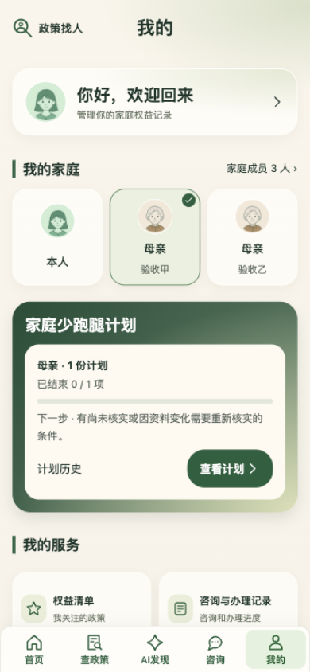

渐变计划卡已恢复；六个服务入口图标、标题和说明完整且对齐。

[补充状态](15b-mine-services.png)

### 16. 家庭成员管理 — 良好

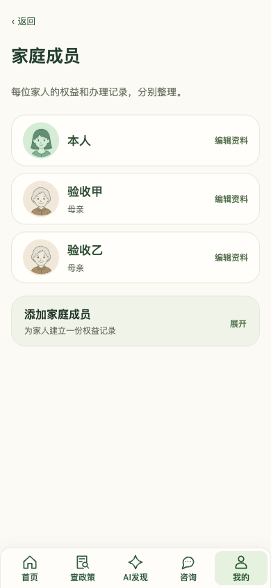

默认先看成员全貌，编辑按需展开，字段与保存/归档操作完整。

[补充状态](16b-family-member-edit.png)

### 17. 查询历史 — 良好

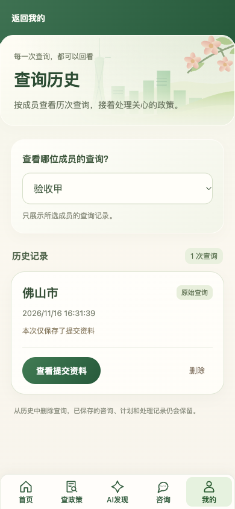

渐变、花枝与城市图案保留；成员切换后只显示该成员记录，空状态为0次查询。

[补充状态](17b-query-history-empty-valid.jpg)

### 18. 本人入口 — 良好

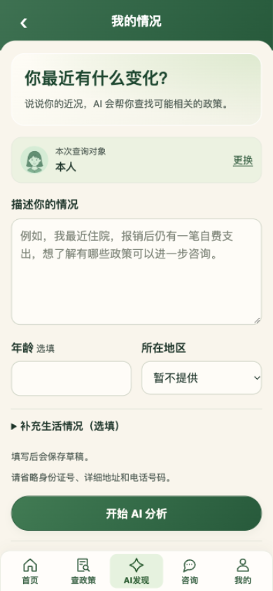

本人入口正确使用本人资料，标题、说明和占位示例都为本人语境。

## 初版与最终版

另提供 [17页初版与最终版比较](../initial-final-20261116/index.html) 和 [四个重点页](../initial-final-20261116/highlights.html)。初版绑定开始优化前的 V3.3 `85718fe`，两版使用相同合成数据和390×844视口；历史页原始导航缺失与滚动后的内容分别标注。

## 修复前后比较

[四处修复对比](fixes.html)将前后截图放在同一画面检查；[全站视觉总览](overview.html)展示十个最终状态。

此组对比操作结果：修复前选验收甲后停在我的服务，修复后选验收乙返回原政策。成员与页面状态不同，不作为同屏像素对齐比较。

其余三组使用相同390×844视口和对应页面比较：收藏提示的位置与宽度、计划页顶部说明、首页卡片文字换行。保留渐变、装饰与内容宽度。

## 检查与验证边界

- 390×844 完整走查；11 个页面在320×844检查无横向溢出、无失败图片；6个代表页面在1280×900检查无横向溢出。截图、布局JSON和可打开的HTML报告均在本目录。
- 收藏选择保留政策ID、所选成员、原搜索参数与返回目标；进入成员管理后也能回到选择页；默认家庭查询入口仍进入 analysis.html。合成收藏保存到验收乙并恢复为原未收藏状态。
- 收藏提示底边小于底部导航顶边，操作反馈不再挡住导航。
- 新增3项导航回归测试通过；改动脚本语法与 git diff --check 通过。
- 最后6页桌面检查未捕获 Runtime.exceptionThrown / Log.entryAdded，事件记录未截断。
- 本轮没有修改后端、政策数据、资格判断或真实用户数据。只在隔离合成库中做了收藏保存和恢复。
- 联网搜索为模拟模式，本轮覆盖加载和无结果状态；不对真实搜索质量、真实AI响应、官方办理或赛事正式合规作结论。
- 观察了标签、原生单选、表单语义、点击尺寸与可见焦点，没有进行完整读屏、全量键盘或正式WCAG审计。
- 截图接口一度出现偏移或固定层缺失，异常图未作为证据；使用校验后的重拍。

## 可选后续

1. 咨询记录表单较长，可把选填材料和后续要求收进分组。
2. 搜索无结果时可增加更醒目的重试或切换来源引导。

这两项涉及使用习惯与画面取舍，本轮未直接重排。