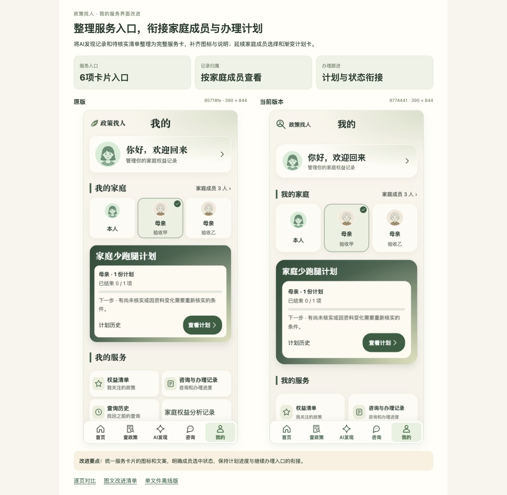
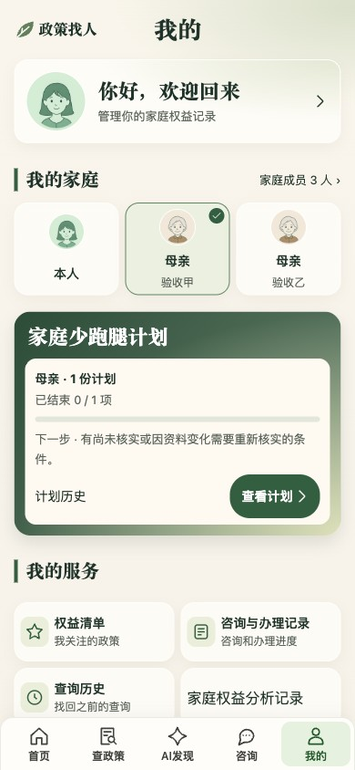
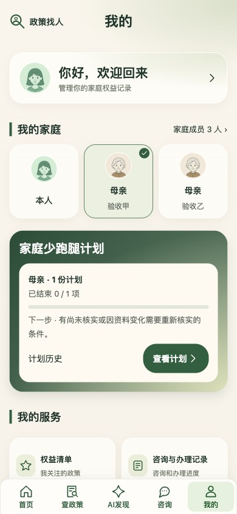
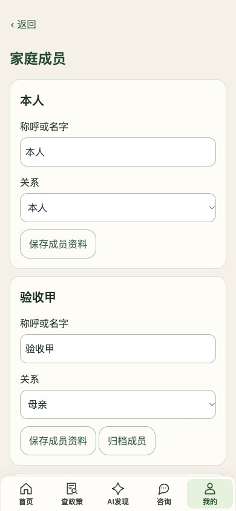

# 当前版本界面改进说明

本报告对照GitHub原版V3.3（85718fe）与当前界面版本（9774441），覆盖17个页面文件、32个界面状态。图片均使用相同合成演示数据和390×844视口。

- [逐页对比 HTML](index.html)
- [完整图文报告 HTML](review.html)
- [单文件离线版：图片已内嵌](offline.html)
- [全部32组图文说明](improvements.md)

主要改进：家庭计划的任务与步骤展示、成员识别与按需编辑、政策详情和收藏对象、服务入口与历史记录，以及基础控件和焦点的一致性。

## 报告配图示例

## 少跑腿计划

加入家庭主题插画、进度摘要、优先办理事项和四步路线。

| 原版 | 当前版本 |
|---|---|
|  |  |

## 我的服务

将AI发现记录和待核实清单整理为完整服务卡，补齐图标与说明，延续成员与计划的展示。

| 原版 | 当前版本 |
|---|---|
|  |  |

## 家庭成员管理

先展示成员卡片，再按需展开编辑。

| 原版 | 当前版本 |
|---|---|
|  |  |

## 本地查看

下载单文件离线版后直接用浏览器打开，图片不依赖本地服务器。文件夹版保留首屏、整页和补充视图；下载整个目录后打开index.html即可。

版本基线与图片说明见[data/sources.json](data/sources.json)。本报告是界面改进说明，演示使用隔离合成数据与预览模式。
