# 32组界面改进图文说明

[交互对比](index.html) · [图文HTML](review.html) · [离线版](offline.html)

## 01. 我的服务

改动类别：服务入口整理

原版展示：服务入口中，AI分析记录以文字链接展示，待核实清单位于次级入口。

当前版本的改动：将AI发现记录、待核实清单纳入服务卡片，补齐图标和说明；统一家庭成员、计划卡与服务区的呈现。

改进作用：服务类别与下一步入口更容易识别，便于继续查询和办理。

| 原版 | 当前版本 |
|---|---|
| 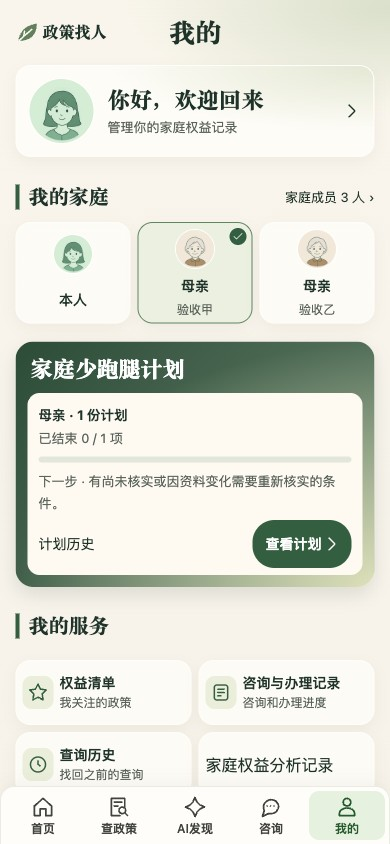 | 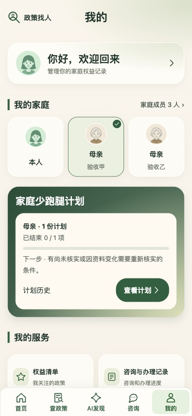 |

## 02. 首页

改动类别：入口与文案完善

原版展示：首页已有家庭插画、渐变背景和本人／家庭入口。

当前版本的改动：保留首页主视觉，优化说明换行；家庭协助直接进入成员选择。

改进作用：保持熟悉的视觉风格，让进入家庭查询的步骤更直接。

| 原版 | 当前版本 |
|---|---|
|  |  |

## 03. AI 发现入口

改动类别：主操作强化

原版展示：AI发现入口包含介绍、开始发现、历史和目录入口。

当前版本的改动：强化开始发现按钮，统一历史与目录的入口样式，保留原有插画和渐变。

改进作用：主操作与辅助操作的区分更清楚。

| 原版 | 当前版本 |
|---|---|
|  |  |

## 04. 成员选择

改动类别：成员识别完善

原版展示：成员选择主要通过姓名和关系文字呈现。

当前版本的改动：增加成员头像、步骤提示和清晰的选中反馈，保留姓名、关系与原生单选控件。

改进作用：更方便识别本次查询对象，减少选错成员的情况。

| 原版 | 当前版本 |
|---|---|
| 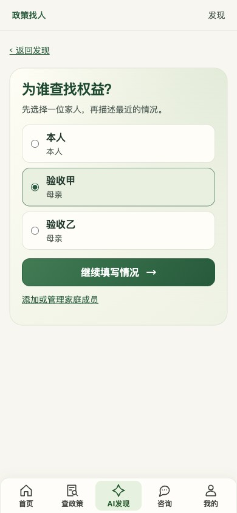 | 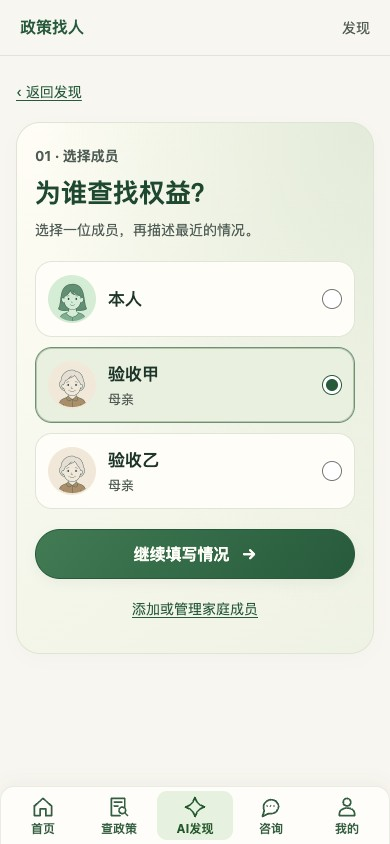 |

## 05. 情况填写

改动类别：填写对象明确

原版展示：情况填写页显示当前成员及基础表单。

当前版本的改动：增加成员头像、姓名、关系和更换入口；统一描述框、字段、提示和主按钮。

改进作用：填写前能清楚确认查询对象，表单操作更连贯。

| 原版 | 当前版本 |
|---|---|
|  |  |

## 06. AI 推荐结果

改动类别：推荐结果梳理

原版展示：推荐页已有政策列表、选中操作和底部下一步。

当前版本的改动：整理政策标题、推荐理由、待核实信息与来源链接；增强选中反馈并统一底部操作区。

改进作用：便于扫读政策重点，持续确认已选数量和下一步。

| 原版 | 当前版本 |
|---|---|
|  | 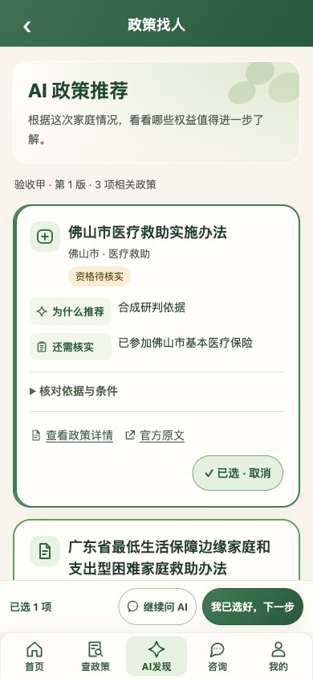 |

## 07. AI 政策详情

改动类别：政策解读完善

原版展示：AI详情以政策简介、相关理由和可展开的条件／依据呈现。

当前版本的改动：将政策简介、适用条件、待确认事项、材料、办理方式和官方来源分区展示；独立展示收藏操作与所属成员。

改进作用：政策信息更完整，收藏对象和官方依据更容易找到。

| 原版 | 当前版本 |
|---|---|
|  |  |

## 08. 目录政策详情

改动类别：详情层级完善

原版展示：目录详情的标题、来源状态、收藏和选人操作分布于多个位置。

当前版本的改动：整理长标题和核验状态，建立独立的收藏对象区；选择成员后可回到原政策继续收藏。

改进作用：政策阅读与收藏衔接更顺畅，成员归属更清楚。

| 原版 | 当前版本 |
|---|---|
|  |  |

## 09. 少跑腿计划

改动类别：计划总览重组

原版展示：计划页以办理对象、计划状态和事项卡分段展示。

当前版本的改动：加入家庭主题插画、真实进度摘要、优先办理事项和四步路线，管理操作按需展开。

改进作用：首屏能够展示当前任务、办理进度和行动路径。

| 原版 | 当前版本 |
|---|---|
|  |  |

## 10. 家庭成员管理

改动类别：成员管理重组

原版展示：家庭成员资料直接以多个编辑表单展示。

当前版本的改动：先展示全部成员卡片，再按需展开编辑；添加成员单独组织。

改进作用：更快看到家庭成员全貌，编辑入口也更明确。

| 原版 | 当前版本 |
|---|---|
| 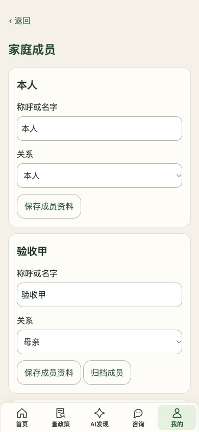 |  |

## 11. 我的计划列表

改动类别：基础样式完善

原版展示：计划列表已有成员选择、计划摘要与打开操作。

当前版本的改动：保留原有业务结构，统一成员选择、卡片、按钮、字号和焦点样式。

改进作用：列表与后续办理页面的视觉衔接更一致。

| 原版 | 当前版本 |
|---|---|
|  |  |

## 12. 待核实事项

改动类别：清单操作整理

原版展示：待核实清单包含政策、条件、纳入计划和后续动作。

当前版本的改动：沿用原有条件与业务动作，整理清单条目、状态文字和主次按钮。

改进作用：更容易区分政策信息、选择状态与后续操作。

| 原版 | 当前版本 |
|---|---|
|  |  |

## 13. 先记下来的政策

改动类别：基础样式完善

原版展示：已保存政策页按所选成员展示记录或空状态。

当前版本的改动：保留成员作用域与空状态，统一标签、选择器和字体。

改进作用：页面与服务中心保持一致的阅读方式。

| 原版 | 当前版本 |
|---|---|
|  |  |

## 14. 咨询与办理记录

改动类别：记录展示整理

原版展示：记录页按咨询记录和状态记录分组。

当前版本的改动：保留原有记录分组和成员选择，统一卡片、字段和间距。

改进作用：不同记录类型的结构更容易辨认。

| 原版 | 当前版本 |
|---|---|
|  |  |

## 15. 条件核对

改动类别：办理步骤完善

原版展示：条件核对页已有步骤导航、待补充项和信息折叠。

当前版本的改动：统一当前步骤、条件列表、状态标签和继续操作的视觉呈现。

改进作用：核对条件时更容易辨认当前位置与待处理事项。

| 原版 | 当前版本 |
|---|---|
|  |  |

## 16. 材料准备

改动类别：材料展示整理

原版展示：材料页已有数量、准备状态与提交前核对入口。

当前版本的改动：保留材料计数和状态语义，整理步骤、材料卡和主操作的样式。

改进作用：材料准备与其他办理步骤的操作方式更一致。

| 原版 | 当前版本 |
|---|---|
|  |  |

## 17. 提交核对与渠道

改动类别：渠道与核对整理

原版展示：提交前核对页包含确认项、条件／材料记录和官方渠道。

当前版本的改动：沿用业务内容，统一步骤导航、确认控件、主次按钮及核对卡片。

改进作用：便于按顺序完成核对并查看办理方式。

| 原版 | 当前版本 |
|---|---|
| 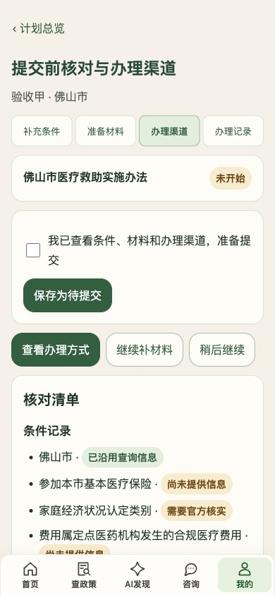 | 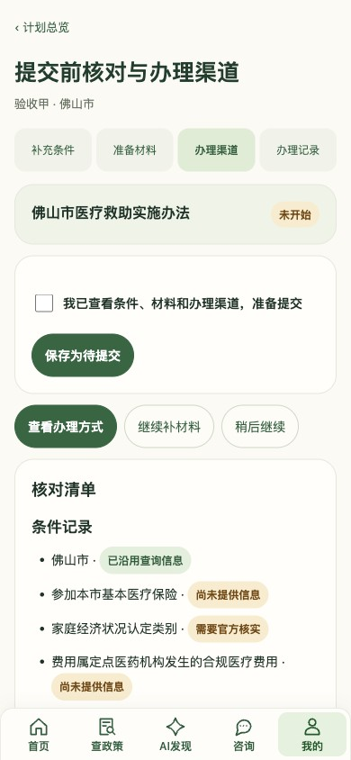 |

## 18. 官方咨询与记录

改动类别：咨询记录整理

原版展示：咨询页展示官方依据、待问问题和记录表单。

当前版本的改动：保持官方咨询与本地记录的区分，统一问题区、表单控件与操作反馈。

改进作用：准备问题、回看依据和记录沟通的衔接更清楚。

| 原版 | 当前版本 |
|---|---|
|  |  |

## 19. 办理进度

改动类别：进度记录整理

原版展示：办理页区分尚未实际提交与实际提交后的记录。

当前版本的改动：保留真实状态和表单语义，统一步骤、状态卡、确认项和结果记录控件。

改进作用：更清楚地查看当前状态并继续记录办理情况。

| 原版 | 当前版本 |
|---|---|
| 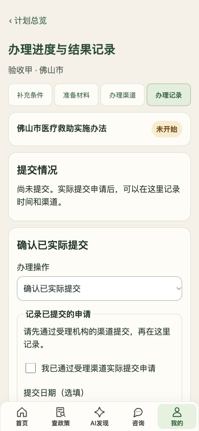 |  |

## 20. 咨询总页

改动类别：咨询入口重组

原版展示：咨询总页以介绍、四个问题和部门目录依次展示。

当前版本的改动：增加咨询准备主区，将四个问题设为按需展开，突出官方依据入口和已有记录；整理部门与政策来源卡。

改进作用：可更早定位官方依据，并在咨询准备与记录之间衔接。

| 原版 | 当前版本 |
|---|---|
|  |  |

## 21. 查询历史

改动类别：历史页展示完善

原版展示：原版历史页存在导航样式缺失，查询内容较为基础。

当前版本的改动：修复导航，加入绿色渐变、花枝和城市图案；按成员整理记录、次数、时间、版本和查看／移除操作。

改进作用：历史记录更易回看，视觉与政策搜索页相互呼应。

| 原版 | 当前版本 |
|---|---|
|  |  |

## 22. 查政策

改动类别：基础样式完善

原版展示：搜索页已有花枝、城市图案、分类和政策卡。

当前版本的改动：沿用原版主体与素材，补充共享字体、链接及焦点规则。

改进作用：保持原有识别度，并与其他页面的基础交互样式衔接。

| 原版 | 当前版本 |
|---|---|
|  |  |

## 23. AI 发现历史

改动类别：分析记录整理

原版展示：AI历史页按成员展示已有分析记录。

当前版本的改动：整理记录行的间距、点击区域与成员选择样式。

改进作用：更便于在成员和历史记录之间切换。

| 原版 | 当前版本 |
|---|---|
| 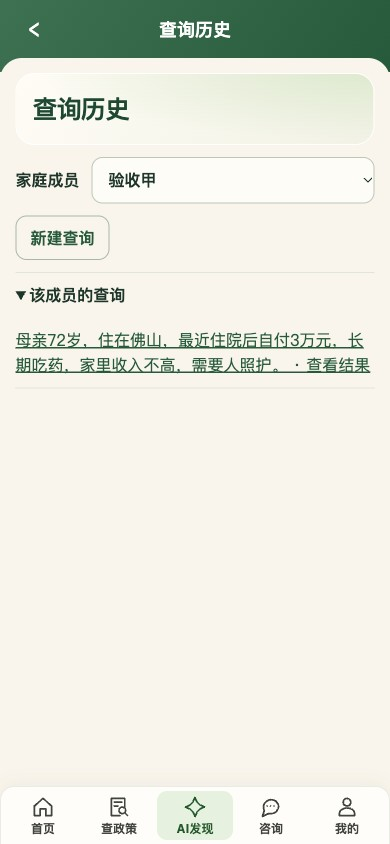 | 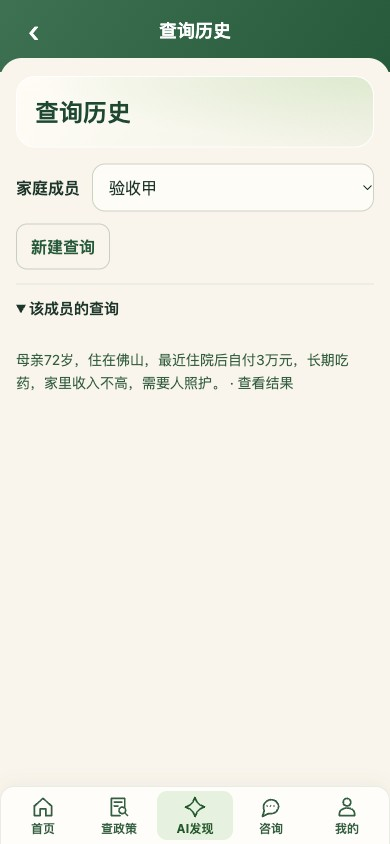 |

## 24. 本人情况填写

改动类别：基础样式完善

原版展示：本人入口已有步骤、家庭插画、本人语境和下一步。

当前版本的改动：沿用原有流程与素材，补充共享字体、控件和可见焦点样式。

改进作用：本人查询保持清楚的对象提示和一致的操作方式。

| 原版 | 当前版本 |
|---|---|
|  | 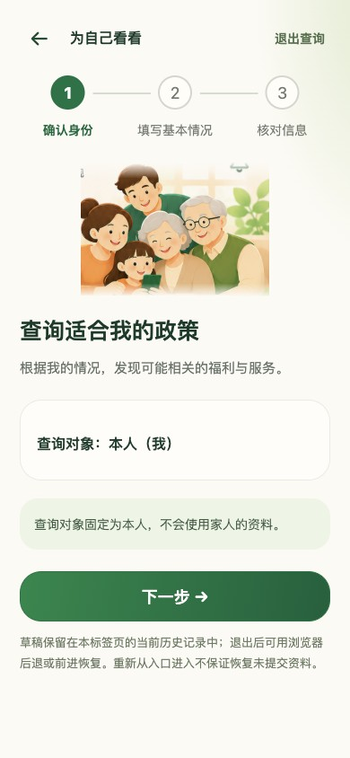 |

## 25. 原政策浏览入口

改动类别：基础控件衔接

原版展示：原浏览入口已有地区、主题和政策列表。

当前版本的改动：保留查询逻辑与叶片装饰，补充共享字体、按钮和选中状态样式。

改进作用：浏览入口与主流程使用相近的基础控件规则。

| 原版 | 当前版本 |
|---|---|
| 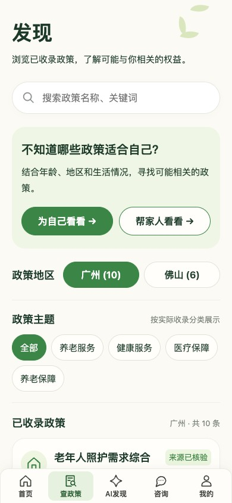 | 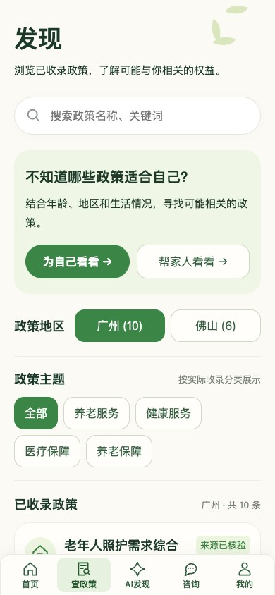 |

## 26. 原发现描述页

改动类别：原流程延续

原版展示：旧结果入口在没有查询资料时显示说明与返回操作。

当前版本的改动：保留资料未提交／不可读取时的提示及返回路径，补充共享基础样式。

改进作用：资料不足时仍有明确的后续入口。本组展示该入口的回退状态。

| 原版 | 当前版本 |
|---|---|
|  |  |

## 27. 原首页兼容页

改动类别：原流程延续

原版展示：原首页兼容入口包含家庭画像与服务入口。

当前版本的改动：保留原有构图、家庭语境与素材，补充共享字体和焦点规则。

改进作用：旧入口可继续使用，并与主流程保持基础样式衔接。

| 原版 | 当前版本 |
|---|---|
|  |  |

## 28. 我的兼容页

改动类别：兼容入口衔接

原版展示：旧“我的”请求由服务端转到服务中心。

当前版本的改动：沿用兼容跳转，承接当前服务入口、成员信息与计划状态。

改进作用：旧链接继续连接当前服务中心。

| 原版 | 当前版本 |
|---|---|
| 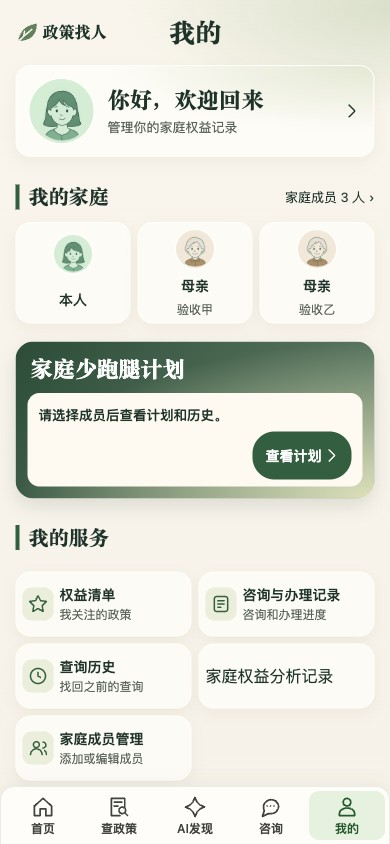 | 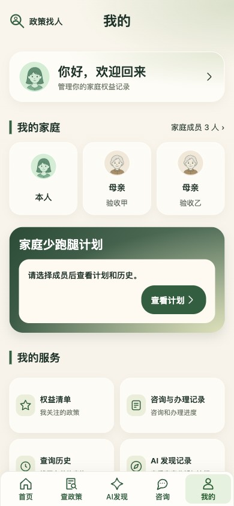 |

## 29. 原计划入口

改动类别：兼容入口衔接

原版展示：旧计划请求由服务端转到相应计划视图。

当前版本的改动：沿用计划承接关系，接入当前计划列表与总览样式。

改进作用：旧入口与当前计划流程保持衔接。

| 原版 | 当前版本 |
|---|---|
| 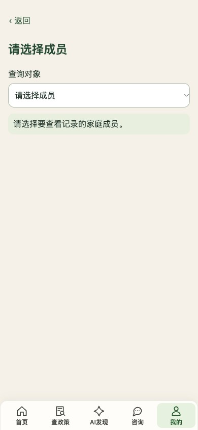 |  |

## 30. 原核实记录

改动类别：兼容入口衔接

原版展示：旧核实记录请求由服务端转到记录视图。

当前版本的改动：保留记录承接关系，使用当前记录页面的成员选择与卡片样式。

改进作用：旧记录入口继续可用。

| 原版 | 当前版本 |
|---|---|
|  |  |

## 31. 原待核实清单

改动类别：兼容入口衔接

原版展示：旧待核实清单请求由服务端转到当前清单。

当前版本的改动：保留清单承接关系，延续成员作用域与当前清单样式。

改进作用：旧链接可继续进入相关成员的事项清单。

| 原版 | 当前版本 |
|---|---|
|  |  |

## 32. 已选权益核对

改动类别：权益核对整理

原版展示：已选权益页已有条件折叠、未知状态与保存操作。

当前版本的改动：统一条件条目、状态标识、展开区和确认按钮的样式。

改进作用：便于核对已知情况，再回到后续结果。

| 原版 | 当前版本 |
|---|---|
| 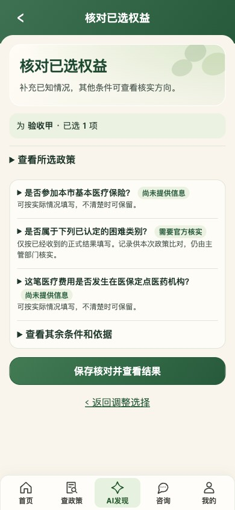 |  |
